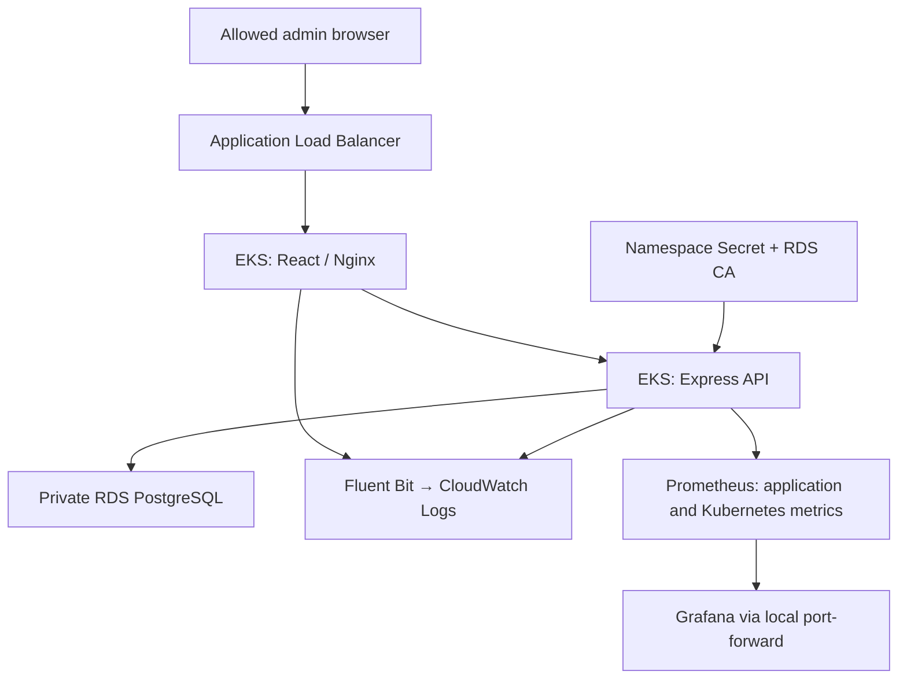
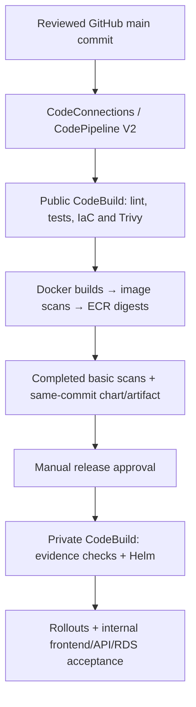

# OpsFlow — AWS EKS Operations Platform

An AWS DevOps portfolio project demonstrating container delivery, infrastructure as code, Kubernetes operations, security checks and application observability.

OpsFlow combines a React status frontend, a Node.js/Express incident API and PostgreSQL. On AWS, the application runs on Amazon EKS with an external Amazon RDS database. The focus is the operational workflow: reviewed code, scanned images, approved releases, verified deployments and correlated logs and metrics.

**AWS region:** `ap-south-1` · **Cluster:** `opsflow-lab` · **Helm release / namespace:** `opsflow`

Implementation and dated execution reports are included. Historical results describe specific runs; they do not imply the lab is currently online.

## Architecture



Terraform owns AWS infrastructure and separate state backends. Helm owns the application release. RDS, application credentials, the CA bundle and the load balancer controller remain external to the application chart.

EKS has private API access and an admin-restricted public endpoint. The private deployment CodeBuild project uses dedicated subnet routing, NAT egress and security-group access to the cluster. It does not receive a public IP.

## Delivery workflow



- **Source:** CodeConnections retrieves the exact GitHub commit without a stored GitHub PAT.
- **Checks:** CI installs locked npm dependencies, runs frontend/backend lint and declared `test:ci` scripts, builds the frontend, validates Terraform and scans secrets, dependencies and static infrastructure configuration.
- **Images:** Both Linux/amd64 images are scanned before either is pushed. Approved deployment inputs use ECR digests; basic ECR scans must be complete.
- **Approval:** The operator reviews the source commit, chart, digests, findings and actual test coverage.
- **Deployment:** CD verifies release evidence and tool checksums, requires an existing healthy release, updates image digests using current Helm values and upgrades with `--atomic --wait`.
- **Acceptance:** It checks rollout status and read-only frontend/API/database readiness through an internal port-forward.
- **Recovery:** A post-upgrade HTTP failure requests rollback to the captured prior revision and verifies internal readiness. A recovered failed run remains failed. Helm rollback does not restore database data, schema or external Secrets.

Queued execution and per-project concurrency limits serialize normal pipeline runs. Execution is intentionally on demand; manual approval is retained. Operators must avoid simultaneous manual Helm changes.

## Security controls

Build and deploy have separate IAM roles. CI has no EKS or Secrets Manager access. CD has no Secrets Manager IAM access, but Helm's namespace permissions include Secrets and workload changes: deployment permission is a sensitive credential trust boundary.

Pinned Trivy and Terraform downloads are checksum-verified. Secret and CRITICAL findings block releases. Qualifying HIGH exceptions must be specific, reviewed and unexpired. Sanitized report checksums and image bindings are verified during deployment.

The current dependency gate scans production dependencies; development dependencies are outside that blocking gate. Frontend automated tests are not declared. Declared backend tests do not establish RDS integration coverage. See the [security implementation](docs/phase12-devsecops.md) and [validation evidence](docs/phase12-validation.md). The latter records preparation checks and failures, not a complete clean live security execution.

## Recorded results

| Capability | Recorded evidence |
|---|---|
| Helm release management | Seven resources adopted; install, upgrade and rollback documented in [Helm results](docs/phase7-results.md) |
| AWS CI/CD delivery | Execution `795f03ce-1f37-4ff6-8fec-e44f479f1a62` succeeded; Helm revision 5 and matching digest-pinned deployments recorded in [CI/CD results](docs/phase9-results.md) |
| Centralized logging | Tagged frontend request reached CloudWatch through Fluent Bit using Pod Identity; [observability results](docs/phase10-results.md) |
| Kubernetes monitoring | 17/17 targets UP, healthy custom rule evaluation and Grafana panels; [observability results](docs/phase10-results.md) |
| Application error investigation | Five synthetic HTTP 500s, five matching CloudWatch records and Prometheus/Grafana observations; [incident report](docs/phase13-results.md) |
| Cost assessment | Displayed October baseline USD 19.28; EKS contributes 42.6%; [cost report](docs/phase14-ccost-optimization.md) |

These are dated examples, not a claim of the latest revision or current resource health.

## Observability and troubleshooting

Fluent Bit forwards application logs to `/opsflow/opsflow-lab/application`. Prometheus collects availability, CPU, memory, restart and application counters. Grafana dashboards are provisioned through ConfigMaps and accessed locally through port-forwarding.

The controlled error listener binds to Pod loopback, starts disarmed, expires after two minutes and allows at most five synthetic errors per activation. Synthetic traffic is separated from real API metrics. Run/request IDs correlate responses with CloudWatch records; Prometheus and Grafana show associated counters and rates.

The incident report records healthy app replicas and database readiness after the exercise. This demonstrates a bounded synthetic investigation, rather than a production outage or comprehensive recovery test.

Two troubleshooting examples:

- **ECR scan initialization:** Bounded retries handled `ScanNotFoundException` immediately after image push, preserving the completed-scan requirement.
- **Grafana sidecar OOM:** Increasing the sidecar limit from 64Mi to 192Mi resolved the recorded memory issue; the report documents a healthy Pod and zero restarts after upgrade.

## Technology and repository map

| Path / area | Tools and purpose |
|---|---|
| `frontend/` | React, Vite, Nginx, Dockerfile; platform status UI |
| `backend/` | Node.js, Express, PostgreSQL client, health/readiness and incident API |
| `database/`, `compose.yaml` | Local database initialization and Docker Compose |
| `helm/opsflow/` | AWS application chart |
| `infrastructure/` | Terraform: state bootstrap, VPC/ECR, EKS/RDS, CI/CD and logging |
| `kubernetes/` | Local manifests, AWS templates, RBAC and monitoring resources |
| `ci/`, `security/` | CodeBuild scripts, Trivy policy, evidence contract, tool pins and lint configuration |
| `scripts/` | PowerShell/Python operational helpers |
| `docs/` | Runbooks, validation reports and execution evidence |

AWS services include EKS, EC2, ECR, RDS, ALB, S3, IAM, Secrets Manager, CodePipeline, CodeBuild, CodeConnections and CloudWatch. Monitoring uses Prometheus, Grafana and Fluent Bit.

## Application and local preview

The frontend displays platform/API health and API version. Incident records are managed through the REST API; the current frontend is not a full incident CRUD console.

| Endpoint | Purpose |
|---|---|
| `GET /health` | Process health |
| `GET /ready` | Database connectivity |
| `GET /api/incidents` | List incidents |
| `GET /api/incidents/:id` | Read an incident |
| `POST /api/incidents` | Create an incident |
| `PATCH /api/incidents/:id/status` | Update status |
| `DELETE /api/incidents/:id` | Delete an incident |

With Docker Desktop and Git installed, run PowerShell from the repository root:

```powershell
Copy-Item .env.example .env
# Set local database values in .env; keep it out of Git.
docker compose up --build -d
docker compose ps
Invoke-RestMethod http://localhost:8080/health
Invoke-RestMethod http://localhost:8080/ready
```

Open `http://localhost:8080`. Stop local containers with `docker compose down`; this retains the database volume. Compose/kind use local PostgreSQL. The AWS Helm release uses external RDS. Local commands do not create or delete AWS infrastructure.

## Deployment and evidence guides

The AWS pipeline deploys an existing Helm release; it does not provision EKS/RDS or bootstrap the first installation. Follow each guide's prerequisite and ownership checks. Discover actual state, account, subnet, image and endpoint values from your environment.

- [Application deployment](docs/phase6-real-application-deployment.md)
- [Helm packaging and adoption](docs/phase7-helm.md)
- [AWS CI/CD](docs/phase9-ci-cd.md)
- [DevSecOps gates](docs/phase12-devsecops.md)
- [Controlled error investigation](docs/phase13-incident-lab.md)
- [Cost assessment](docs/phase14-ccost-optimization.md)
- [Portfolio evidence and interview walkthrough](docs/portfolio-guide.md)

## Lab boundaries and costs

This is an operations lab. Configuration includes public worker subnets, admin-restricted HTTP ingress, Single-AZ RDS and Kubernetes-managed app credentials. The application has no authentication. Monitoring storage is ephemeral and retention is bounded. Alert rules are evaluated, but external notifications are not configured.

Internal acceptance does not prove ALB routing. The incident report identifies final browser/disarm confirmations it did not capture. These boundaries matter when interpreting the evidence.

EKS, workers, RDS, ALB, NAT/public IPv4 and storage can continue costing money while the laptop is off. On-demand triggering does not stop those charges. Preserve Terraform state, deployment evidence and rollback images before using the appropriate guide's reviewed teardown. CI/CD-only teardown leaves application infrastructure running. Measured savings are not claimed.
