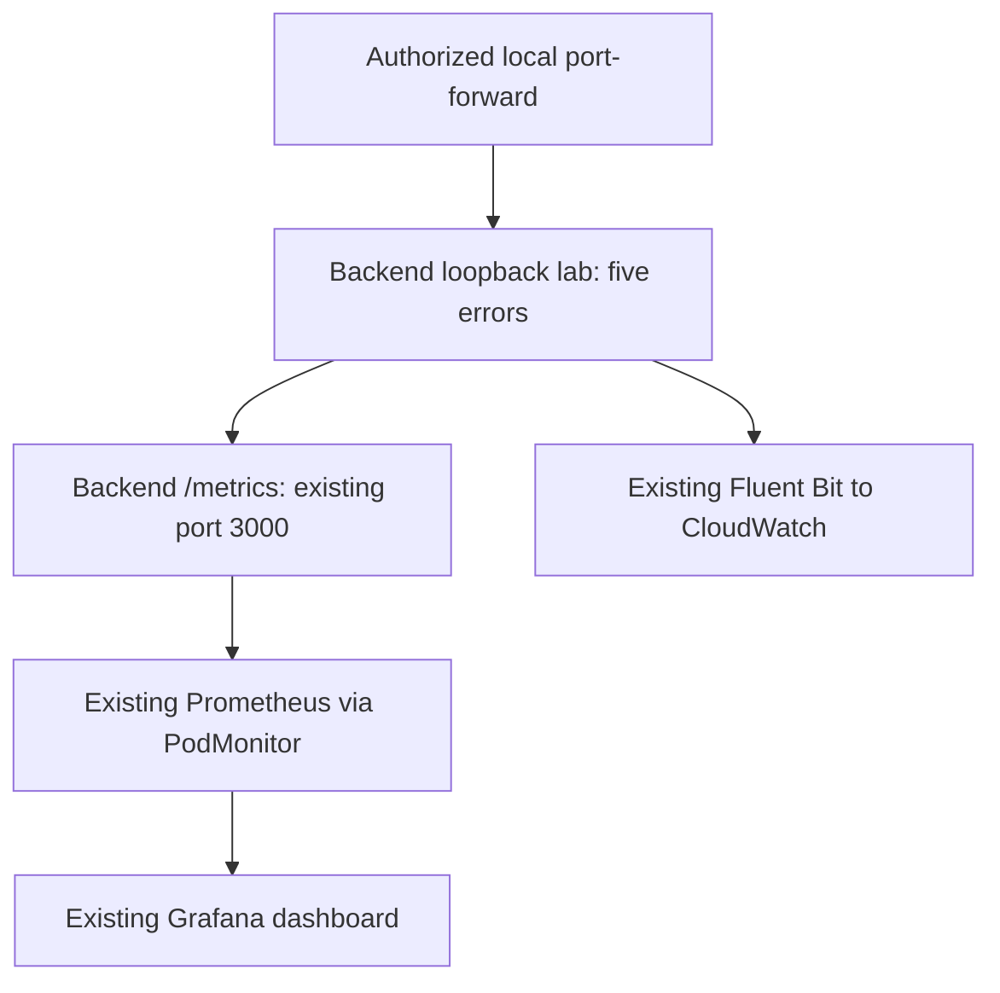

# Phase 13 — Controlled application-error investigation

## Objective, scope and current status

Generate five explicitly synthetic HTTP 500 responses on one existing backend Pod. Correlate response request IDs/run ID with CloudWatch logs, Prometheus counters and a Grafana dashboard. Confirm the real API remains healthy, then leave the lab disarmed.

No Pod deletion, bad-image drill, database failure, load test, credential mutation or node scaling is included. This demonstrates error detection and investigation, not recovery from a real outage. A healthy readiness endpoint does not make HTTP 500 responses disappear automatically; stopping the intentional trigger resolves this exercise.

This package is prepared code. No AWS execution, Helm deployment or live incident test was performed during preparation. Mark live steps complete only from actual outputs. Phase 12 pipeline success for this new source and an operational Phase 10 stack are prerequisites. A historical pipeline success or dashboard screenshot does not establish either current prerequisite.

## Architecture and resources



The app now exports two small counter families in Prometheus text format. Labels are bounded: fixed source and HTTP status. Request/run IDs and raw URLs never become metric labels. Requests to `/metrics` are excluded from the normal response counter. Synthetic errors are separated from production responses, so they do not contaminate the new production 5xx panel. This is narrow instrumentation, not a complete latency/SLO/process-metrics implementation.

The test listener binds only `127.0.0.1:3001` inside the backend Pod. It is disarmed by default; POST `/arm` creates a server-generated run ID, allows at most five errors and expires after two minutes. GET `/error` also requires that run ID in a header. The public API on port 3000 has no arm/error routes. The existing Service/Ingress does not expose port 3001. Kubernetes port-forward permissions are the access boundary; the run ID is a correlation/control value, not a substitute for authorization. Anyone with Pod exec/port-forward or same-Pod access can potentially arm the lab. Do not expose port 3001 through a Service, Ingress, host port or public local bind.

No new npm dependency, AWS resource, container, Pod or worker node is added. Two monitoring objects are created: one PodMonitor and one dashboard ConfigMap. Prometheus discovers the existing backend Pod's named `http` port. The actual live PodMonitor selector is read before generating the monitor; no blanket monitoring-selector change is made. These objects remain outside the seven-resource OpsFlow chart and are applied by the authorized operator in `monitoring`. CI deployer RBAC is not broadened.

The existing chart's latest capacity-safe rolling-update strategy is retained; this package does not edit the chart, replica counts or resource requests. The code deploy is a normal approved release, not an incident drill. It may still cause normal rolling-update effects; verify capacity/baseline first.

## Files

```
backend/src/app.js                         # metrics middleware and /metrics
backend/src/server.js                      # loopback listener and graceful close
backend/src/observability/incidentLab.js
backend/tests/incidentLab.test.js
kubernetes/phase13/podmonitor-template.json
kubernetes/phase13/dashboard-configmap.json
scripts/phase13/Apply-Phase13.ps1
scripts/phase13/New-Monitor.ps1
scripts/phase13/Invoke-IncidentLab.ps1
docs/phase13-incident-lab.md
docs/phase13-results-template.md
docs/phase13-validation.md
.phase13/.gitignore
```

## 1. Merge locally and review

Download `OpsFlow_Phase13_Incident_Lab.zip` into Downloads. Use a fresh extraction folder; preserve an existing one rather than mixing versions.

```powershell
$OpsRepoRoot = 'C:\Users\ROHIT\Desktop\aws-eks-ops-platform'
$OpsPhase13Source = 'C:\Users\ROHIT\Desktop\opsflow-phase13'
if (Test-Path $OpsPhase13Source) { throw 'Extraction target exists; preserve it and use a fresh path' }
Expand-Archive -LiteralPath "$env:USERPROFILE\Downloads\OpsFlow_Phase13_Incident_Lab.zip" `
    -DestinationPath 'C:\Users\ROHIT\Desktop'
& "$OpsPhase13Source\scripts\phase13\Apply-Phase13.ps1" -RepoRoot $OpsRepoRoot
Set-Location $OpsRepoRoot
git status --short
git --no-pager diff -- backend/src/app.js backend/src/server.js
git check-ignore .phase13/example-runtime.json
```

Installer hashes guard the two modified existing files against reviewed repository commit `2736a37e589a62485adf3d72392f85cfb817e590`, allowing CRLF. Unexpected changes stop the installer before writes. Backups go under ignored `.phase13/`. Preserve them; never stage the runtime directory wholesale. If the downloaded script is blocked, inspect it and unblock that specific file; do not change machine-wide execution policy.

## 2. Verify current environment before release

Use your intended already-authorized profile. The current project profile is `opsflow-admin-role`; if renamed, use the actual profile. Do not switch accounts or print credentials.

```powershell
$OpsRegion = 'ap-south-1'
$OpsContext = 'opsflow-eks'
$OpsPipeline = 'opsflow-lab-application'
$env:AWS_PROFILE = 'opsflow-admin-role'
$env:AWS_REGION = $OpsRegion
$env:AWS_DEFAULT_REGION = $OpsRegion
$env:AWS_PAGER = ''
$OpsAccount = aws sts get-caller-identity --query Account --output text
if ($LASTEXITCODE -ne 0 -or $OpsAccount.Trim() -ne '952078551971') { throw 'Intended authorized account required' }
helm status opsflow -n opsflow --kube-context $OpsContext
if ($LASTEXITCODE -ne 0) { throw 'Healthy existing Helm release required' }
kubectl --context $OpsContext get deployments,pods -n opsflow
kubectl --context $OpsContext get pods,services,prometheus -n monitoring
aws codepipeline list-pipeline-executions --pipeline-name $OpsPipeline --region $OpsRegion `
    --max-items 5 --query 'pipelineExecutionSummaries[].{Id:pipelineExecutionId,Status:status}' --output table
```

Stop if application/monitoring Pods are unhealthy or another pipeline is active. Do not run this lab during deployment/recovery. Existing monitoring must fit the nodes already; this package does not repair capacity by adding nodes. Keep `detect_changes=false`.

## 3. Commit and deploy through the existing approved pipeline

The preparation tests already cover disabled behavior, expiry, five-error limit, request-ID log correlation, public route exclusion and actual loopback binding. CI reruns the real suites against the reviewed source. Do not run unrelated full CRUD/failure drills.

```powershell
Set-Location $OpsRepoRoot
git add backend/src/app.js backend/src/server.js backend/src/observability/incidentLab.js `
    backend/tests/incidentLab.test.js kubernetes/phase13 scripts/phase13 `
    docs/phase13-incident-lab.md docs/phase13-results-template.md docs/phase13-validation.md .phase13/.gitignore
git --no-pager diff --cached --stat
git --no-pager diff --cached --name-only
git --no-pager diff --cached
# No real .env, private Terraform files, runtime backups or credentials may be staged.
git commit -m 'feat: add bounded application error observability lab'
if ($LASTEXITCODE -ne 0) { throw 'Commit failed' }
git push origin main
if ($LASTEXITCODE -ne 0) { throw 'Push failed' }
$OpsStart = aws codepipeline start-pipeline-execution --name $OpsPipeline --region $OpsRegion --output json
if ($LASTEXITCODE -ne 0) { throw 'Pipeline start failed' }
$OpsExecutionId = ($OpsStart | ConvertFrom-Json).pipelineExecutionId
Write-Host "Execution ID: $OpsExecutionId"
aws codepipeline list-action-executions --pipeline-name $OpsPipeline `
    --filter "pipelineExecutionId=$OpsExecutionId" --region $OpsRegion `
    --query 'actionExecutionDetails[].{Stage:stageName,Action:actionName,Status:status,Error:output.executionResult.errorDetails.message}' `
    --output table
```

Follow Phase 12's actual build/scan/artifact review. Approve only this execution with passing gates and accepted findings/test gaps. Do not weaken gates to get the lab deployed. Stop at a real failure; do not keep rebuilding an unchanged failing commit. No manual Helm upgrade competes with CI.

After deployment:

```powershell
aws codepipeline get-pipeline-execution --pipeline-name $OpsPipeline `
    --pipeline-execution-id $OpsExecutionId --region $OpsRegion `
    --query 'pipelineExecution.{Id:pipelineExecutionId,Status:status,Source:artifactRevisions}' --output json
helm history opsflow -n opsflow --kube-context $OpsContext
kubectl --context $OpsContext get deployments -n opsflow
```

Expected: this source's pipeline Succeeded, a deployed Helm revision, healthy desired replicas and approved digests. The current frontend remains unchanged in behavior; both images may be rebuilt by the simple existing pipeline. Record the actual revision/digests. Do not arm the lab before a settled successful deployment.

## 4. Apply only the monitoring objects

```powershell
& .\scripts\phase13\New-Monitor.ps1 -RepoRoot $OpsRepoRoot -Context $OpsContext
kubectl --context $OpsContext apply --dry-run=server -f .\.phase13\podmonitor.json
if ($LASTEXITCODE -ne 0) { throw 'PodMonitor validation failed' }
kubectl --context $OpsContext apply --dry-run=server -f .\kubernetes\phase13\dashboard-configmap.json
if ($LASTEXITCODE -ne 0) { throw 'Dashboard validation failed' }
kubectl --context $OpsContext apply -f .\.phase13\podmonitor.json
if ($LASTEXITCODE -ne 0) { throw 'PodMonitor apply failed' }
kubectl --context $OpsContext apply -f .\kubernetes\phase13\dashboard-configmap.json
if ($LASTEXITCODE -ne 0) { throw 'Dashboard apply failed' }
```

The generator rejects unmanaged/multiple/expression-based Prometheus selections rather than broadening them. If your stack differs, inspect its actual selectors and update only the intended monitor's labels after review. Do not apply the empty-label template directly.

## 5. Open local access and establish a scrape baseline

Select one running Ready backend Pod in the main PowerShell window:

```powershell
$OpsPodRaw = kubectl --context $OpsContext get pods -n opsflow -l app=backend -o json
if ($LASTEXITCODE -ne 0) { throw 'Pod lookup failed' }
$OpsReadyPods = @((($OpsPodRaw -join "`n") | ConvertFrom-Json).items | Where-Object {
    $_.status.phase -eq 'Running' -and @($_.status.conditions | Where-Object { $_.type -eq 'Ready' -and $_.status -eq 'True' }).Count -gt 0
})
if ($OpsReadyPods.Count -eq 0) { throw 'No Ready backend Pod' }
$OpsPod = ($OpsReadyPods | Sort-Object { $_.metadata.name } | Select-Object -First 1).metadata.name
Write-Host "Selected Pod: $OpsPod"
```

Open three additional PowerShell terminals. Substitute the actual selected Pod name in terminal A; variables are not shared between terminals.

```powershell
# Terminal A — same Pod for metrics and lab controls; keep this running.
kubectl --context opsflow-eks -n opsflow port-forward pod/ACTUAL_SELECTED_BACKEND_POD `
    13000:3000 13001:3001 --address 127.0.0.1

# Terminal B — existing Prometheus, keep running.
kubectl --context opsflow-eks -n monitoring port-forward service/opsflow-monitoring-prometheus `
    19090:9090 --address 127.0.0.1

# Terminal C — existing Grafana, keep running.
kubectl --context opsflow-eks -n monitoring port-forward service/opsflow-monitoring-grafana `
    13080:80 --address 127.0.0.1
```

Service names follow Phase 10's fullnameOverride; verify the live `get services` output first. Use actual names if different. Do not expose Grafana or Prometheus through a new ALB/public allowlist.

Back in the main terminal:

```powershell
$OpsHealth = Invoke-RestMethod 'http://127.0.0.1:13000/health' -TimeoutSec 10
$OpsReady = Invoke-RestMethod 'http://127.0.0.1:13000/ready' -TimeoutSec 15
if ($OpsHealth.status -ne 'healthy' -or $OpsReady.status -ne 'ready' -or $OpsReady.database -ne 'connected') { throw 'Real application baseline failed' }
Invoke-RestMethod 'http://127.0.0.1:13001/status' -TimeoutSec 10
# Expected armed=false and the selected Pod name. Do not arm yet.
function Get-Phase13Counter {
    $Query = 'opsflow_incident_lab_errors_total{namespace="opsflow",job="monitoring/opsflow-incident-lab",pod="' + $OpsPod + '"}'
    $Reply = Invoke-RestMethod ('http://127.0.0.1:19090/api/v1/query?query=' + [Uri]::EscapeDataString($Query)) -TimeoutSec 15
    if ($Reply.status -ne 'success' -or @($Reply.data.result).Count -ne 1) { throw 'Expected one selected-Pod series; inspect target/labels/duplicate monitors' }
    return [double]$Reply.data.result[0].value[1]
}
$OpsBeforeCounter = Get-Phase13Counter
Write-Host "Prometheus baseline counter: $OpsBeforeCounter"
```

Open Prometheus `http://127.0.0.1:19090/targets` and confirm the new `monitoring/opsflow-incident-lab` target is UP. Allow at least two 30-second scrapes before the exercise, so rate/increase graphs have a pre-error baseline. Open Grafana `http://127.0.0.1:13080` using your existing Phase 10 login; never print or commit its password. Find **OpsFlow — Controlled Application Error Lab**, select the existing Prometheus datasource and verify real series. Missing data is not a zero-error pass. An empty dashboard before the first scrape is expected; fix persistent absence before testing.

## 6. Generate exactly five controlled errors once

```powershell
& .\scripts\phase13\Invoke-IncidentLab.ps1 -RepoRoot $OpsRepoRoot -Pod $OpsPod
```

The script verifies the loopback listener belongs to the selected Pod, rejects an already armed run, issues at most five requests, verifies each response is a synthetic 500 with matching run/request IDs, and disarms in `finally`. It verifies a same-Pod local counter delta of five and saves non-secret request evidence under `.phase13/run-UUID.json`.

Expected output: five synthetic 500s, five request IDs, a run ID, local counter delta five and `armedAfter=false`. This proves only HTTP/local instrumentation behavior. It does not yet prove CloudWatch, Prometheus or Grafana ingestion. If the script fails, stop and inspect; partial runs may have generated fewer errors. Do not automatically start another run.

Do not use ordinary ALB/API endpoints to generate this failure. Do not delete Pods, change readiness, alter DB configuration or send traffic loops.

## 7. Verify Prometheus and Grafana

After the next scrape, in the main terminal:

```powershell
$OpsAfterCounter = Get-Phase13Counter
$OpsPrometheusDelta = $OpsAfterCounter - $OpsBeforeCounter
Write-Host "Selected-Pod Prometheus counter delta: $OpsPrometheusDelta"
# Expected five, provided there was no restart/concurrent run. Refresh the query if a scrape is still pending.
```

On the dashboard, select the matching last-15-minute window and inspect the selected Pod's synthetic counter increase and synthetic error rate. The production 5xx panel excludes synthetic errors. Available replicas/readiness should remain healthy; CPU/memory need not show a visible spike from five tiny requests. Do not generate heavier traffic to manufacture a resource graph.

Useful PromQL:

```promql
opsflow_incident_lab_errors_total{namespace="opsflow",job="monitoring/opsflow-incident-lab"}
sum(increase(opsflow_incident_lab_errors_total{namespace="opsflow",job="monitoring/opsflow-incident-lab"}[5m]))
sum(rate(opsflow_http_responses_total{namespace="opsflow",job="monitoring/opsflow-incident-lab",source="incident_lab",status="500"}[5m]))
sum(rate(opsflow_http_responses_total{namespace="opsflow",job="monitoring/opsflow-incident-lab",source="production",status=~"5.."}[5m]))
```

`increase()` extrapolates and can return fractional values; do not demand exactly five from that function. The same-Pod before/after counter snapshots establish the exact delta if no restart intervened. Counters reset on process restart; do not delete a Pod during this lab. Metrics correlate by Pod and time; request IDs live only in logs, not in Prometheus labels. No CloudWatch Grafana datasource/IAM integration or notification is added; log investigation remains in CloudWatch.

## 8. Find the matching CloudWatch logs

Use the actual run ID printed by the script. Load its exact evidence file in the main PowerShell scope; do not rely on variables created inside the child script.

```powershell
$OpsRunId = 'ACTUAL_RUN_UUID'
$OpsRun = Get-Content (Join-Path $OpsRepoRoot ('.phase13\run-' + $OpsRunId + '.json')) -Raw | ConvertFrom-Json
$OpsRunStartMs = ([DateTimeOffset]::Parse($OpsRun.startedUtc)).AddMinutes(-2).ToUnixTimeMilliseconds()
$OpsFilter = @{
    logGroupName = '/opsflow/opsflow-lab/application'
    filterPattern = '"' + $OpsRunId + '"'
    startTime = $OpsRunStartMs
}
$OpsFilterPath = Join-Path $OpsRepoRoot '.phase13\log-filter.json'
[IO.File]::WriteAllText($OpsFilterPath, ($OpsFilter | ConvertTo-Json), (New-Object Text.UTF8Encoding($false)))
aws logs filter-log-events --cli-input-json file://.phase13/log-filter.json --region $OpsRegion --output json
if ($LASTEXITCODE -ne 0) { throw 'CloudWatch query failed' }
kubectl --context $OpsContext logs $OpsPod -n opsflow -c backend --since=15m | Select-String -SimpleMatch $OpsRunId
```

Expect five application log events with `event=opsflow_incident_lab_error`, `synthetic=true`, HTTP status 500, the actual Pod, run ID and response request IDs. Log delivery can lag; repeat the read-only query after delivery time, not the error requests. If ingestion duplicates occur, verify five distinct request IDs rather than trusting raw event count. Empty results mean CloudWatch verification is pending, not passed.

CloudWatch Logs Insights alternative (select the existing application log group and exact UTC time window):

```text
fields @timestamp, @message, @logStream
| filter @message like /ACTUAL_RUN_UUID/
| sort @timestamp asc
| limit 20
```

Inspect the actual message shape: Fluent Bit may expose parsed fields at the top level or retain JSON under `log`. Filtering `@message` avoids assuming one schema. Match request IDs to response evidence. No SQL/incident bodies/passwords are emitted by this synthetic logger. Do not paste unrelated logs or secrets into evidence. A local `kubectl logs` match alone is not CloudWatch success.

## 9. Resolve, verify normal service, record evidence

```powershell
Invoke-RestMethod 'http://127.0.0.1:13001/status' -TimeoutSec 10
# Expected armed=false.
$OpsHealth = Invoke-RestMethod 'http://127.0.0.1:13000/health' -TimeoutSec 10
$OpsReady = Invoke-RestMethod 'http://127.0.0.1:13000/ready' -TimeoutSec 15
if ($OpsHealth.status -ne 'healthy' -or $OpsReady.status -ne 'ready' -or $OpsReady.database -ne 'connected') { throw 'Real application acceptance failed; investigate without further injections' }
kubectl --context $OpsContext get deployments,pods -n opsflow
```

Open the existing ALB once from your allowed admin IP and confirm the frontend and read-only incident listing still work. No new incident or full CRUD drill is needed. Close all three port-forward terminals with Ctrl+C. The lab remains disarmed; if interrupted, the server expires it within two minutes. Existing counters remain cumulative until restart; rate/increase graphs age out over their time windows rather than immediately returning to zero.

Fill `docs/phase13-results.md` from the template. Record actual deployment/execution/digests, Pod/run ID, start/end UTC, five distinct request IDs, exact local/Prometheus deltas, Grafana observations, CloudWatch log matches, readiness/public acceptance, disarm and cost/cleanup status. No automatic script claims those later steps passed. A screenshot is supporting evidence, not a replacement for target/counter/log verification.

```powershell
Copy-Item .\docs\phase13-results-template.md .\docs\phase13-results.md
code .\docs\phase13-results.md
# Fill actual evidence, then add a short link from your existing README.
git add docs/phase13-results.md README.md
git --no-pager diff --cached
git commit -m 'docs: record controlled application error investigation'
if ($LASTEXITCODE -ne 0) { throw 'Evidence commit failed' }
git push origin main
```

No documentation-only deployment is required with triggers disabled.

## Troubleshooting

| Symptom | Action |
|---|---|
| Installer hash mismatch | Preserve current edits; reconcile only the app/server changes; do not force overwrite |
| CI gate failure | Inspect actual Phase 12 report and fix/review the finding; do not bypass |
| Port 3001 connection refused | Confirm the newly approved image reached the selected Pod; inspect safe listener-unavailable event; do not add a public Service |
| Wrong Pod or UUID mismatch | Use the same explicit Pod for both forwards, status and Prometheus selector |
| Lab 404 | Expected while disabled/expired/exhausted or with wrong run ID; do not retry traffic blindly |
| Prometheus target absent | Live PodMonitor labels/namespace selectors/CRD/operator RBAC and named `http` port |
| Target DOWN | Check `/metrics` response/content type, network policy and target error; do not broaden all SGs |
| Grafana no data | Correct datasource/time window and scrape baseline; not a zero |
| CloudWatch absent | Check this backend's stdout, Fluent Bit coverage/delivery/Pod Identity permissions; local logs are not ingestion proof |
| Counter differs | Pending scrape, wrong Pod/job, duplicate scrape, concurrent activation or process restart |
| Real readiness/replicas fail | Stop injection and investigate real issue; no automatic DB/credential change |

## Costs and cleanup

No new billable AWS infrastructure is provisioned. Existing EKS/RDS/NAT/EIP/ALB/monitoring costs continue. The code release consumes existing CodeBuild minutes and ECR/artifact storage; five logs plus counter scrapes add small ingestion/storage work, not a free-tier guarantee. Prometheus/Grafana remain the Phase 10 ephemeral-storage lab stack; export evidence before its retention window or Pod restart removes it.

Keep the narrow metrics/dashboard if useful, with the lab disarmed. To remove only Phase 13 monitoring metadata after evidence is saved:

```powershell
kubectl --context $OpsContext delete podmonitor opsflow-incident-lab -n monitoring
kubectl --context $OpsContext delete configmap opsflow-phase13-dashboard -n monitoring
```

This does not remove the loopback listener from the deployed image. Permanently removing the lab code requires a separately reviewed source change and approved pipeline release; do not blindly restore old app/server backups over later changes. No Helm uninstall or Terraform destroy is needed for these two objects. Full-lab teardown follows existing phase dependency order, preserving state/data and stopping builds first.

Completion: a real successful reviewed code deployment, five controlled errors, matching CloudWatch logs, Prometheus/Grafana evidence, healthy real app, disarmed lab, and committed honest incident report. No production outage recovery, autoscaling, alert notification, comprehensive APM or distributed tracing is claimed.

Primary references: [Prometheus text exposition](https://prometheus.io/docs/instrumenting/exposition_formats/), [Prometheus functions](https://prometheus.io/docs/prometheus/latest/querying/functions/), [Prometheus Operator API](https://prometheus-operator.dev/docs/api-reference/api/), [kubectl port-forward](https://kubernetes.io/docs/reference/kubectl/generated/kubectl_port-forward/), [CloudWatch filter patterns](https://docs.aws.amazon.com/AmazonCloudWatch/latest/logs/FilterAndPatternSyntax.html).
