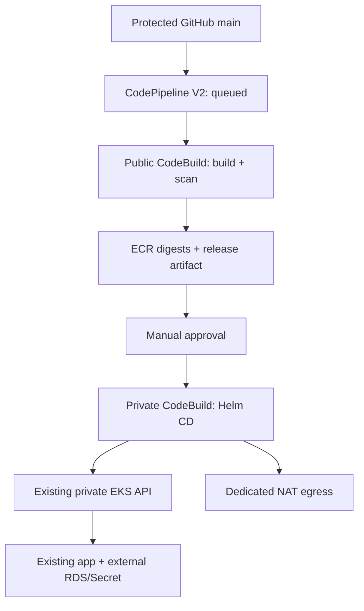

# Phase 9 — AWS CI/CD for the existing Helm application

## 1. Objective and current state

Automate reviewed GitHub main commits into CodeBuild builds, digest-pinned ECR images, completed basic scans, an explicit approval and a Helm upgrade of the existing OpsFlow release. Your Phase 8 report says the application-credential backup succeeded and AWSCURRENT was verified. This pipeline does not repeat that operation, rotate DB passwords, migrate PostgreSQL or run Terraform against the existing EKS/RDS automatically.

This package provides complete infrastructure and CI/CD code; no live AWS provisioning/execution was performed while preparing it. Mark each step complete only from actual successful outputs. A prepared buildspec is not a working pipeline.

New billable infrastructure includes a NAT gateway and Elastic IP for the private deployment build. They cost money even when builds are idle. This is not a free-tier-only design. Use a bounded lab window and the Phase 9-only teardown below if you won't keep it running.

## 2. Architecture and production relevance



Build and deploy have separate IAM roles. CI can push only to the two existing repositories; it has no EKS or Secrets Manager access. CD can describe the existing cluster/images and use the namespace deployer group; it cannot push images or call Secrets Manager. CodePipeline uses CodeConnections instead of a stored GitHub PAT. Neither build receives a database password through AWS environment variables.

CD uses the **private EKS endpoint**, with a new security-group rule for TCP443 from its SG to the cluster SG. The admin public /32 remains unchanged. A dedicated subnet/route table uses NAT for AWS API/CodeBuild/artifact access. Existing EKS/RDS subnet routes are not altered. CodeBuild ENIs do not get public IPs; merely choosing a public subnet would fail. A single NAT in the same AZ is a lab cost/availability choice, not HA.

Pipeline V2 QUEUED plus per-project concurrency 1 prevents two normal pipeline executions from overlapping Helm operations. It does not protect against an operator simultaneously running Helm. Use a single deployment owner during a run.

## 3. Files and prerequisites

```
ci/
  common.py
  build.py
  deploy.py
  buildspec-ci.yml
  buildspec-cd.yml
infrastructure/phase9/
  versions.tf
  variables.tf
  network.tf
  storage.tf
  iam.tf
  pipeline.tf
  outputs.tf
  backend.hcl.example
  terraform.tfvars.example
kubernetes/phase9/deployer-rbac.yaml
docs/phase9-ci-cd.md
docs/phase9-results-template.md
.phase9/.gitignore
```

Merge these into the existing repository. **Keep your existing helm/opsflow chart and actual application source.** This package doesn't replace them. Required: healthy existing EKS/RDS/ALB, Helm 3 release opsflow already deployed and verified, Phase 5 remote-state outputs, AWS CLI v2/Terraform >=1.10/kubectl, GitHub repo authorization and CodeBuild service quotas. Phase 9 uses a new Terraform backend key, not the Phase 5 key.

The source example is Sampaatil/aws-eks-ops-platform; verify your actual owner/repo before provisioning. The subnet example 10.40.64.0/24 is unused by the supplied Phase 4 design, but must be checked against **current** VPC subnets. Do not use it if current changes overlap. The cluster/tool example is kubectl1.35.0 and Helm3.19.0; select a kubectl within one minor of the real control plane and keep Helm3 for the current chart/flags.

Managed CodeBuild standard:7.0 uses Node22/Python3.12 here. Verify your actual package engines and supported image runtimes. The managed image tag can change underneath builds; a production supply chain should use approved/pinned build images and tools. Helm/kubectl downloads are HTTPS and checked against official companion checksums; the extracted binaries travel in the release artifact, so CD does not need to download tools.

## 4. Repair runtime ignores before committing

Your latest Git status had an untracked `.phase8/` directory. Do not commit its venv/runtime data. Keep the supplied .phase8/.gitignore from Phase 8 and add only that ignore file if missing; inspect the directory before staging. The same pattern applies to `.phase9/`.

```powershell
Set-Location 'C:\Users\ROHIT\Desktop\aws-eks-ops-platform'
$OpsRepoRoot = (Get-Location).Path
$OpsRegion = 'ap-south-1'
$OpsContext = 'opsflow-eks'
$OpsCluster = 'opsflow-lab'
$OpsExpectedAccount = '952078551971'
$env:AWS_REGION = $OpsRegion
$env:AWS_DEFAULT_REGION = $OpsRegion
$env:AWS_PAGER = ''
aws sts get-caller-identity
helm status opsflow -n opsflow --kube-context $OpsContext
aws eks describe-cluster --name $OpsCluster --region $OpsRegion `
  --query 'cluster.{Status:status,Version:version,Network:resourcesVpcConfig}'
git status --short
```

Expected intended account, deployed release, ACTIVE cluster with private access. If infrastructure was destroyed, recreate it deliberately first; the pipeline will not bootstrap Helm or restore RDS.

Check effective .dockerignore in **backend and frontend**: exclude .env/.env.*, real credential files, Git data and node_modules; preserve .env.example only if intentionally needed. Root .gitignore does not control Docker COPY. The CI source check rejects common tracked private/generated filenames, but isn't a comprehensive secret scanner or a full Docker ignore evaluator. Don't commit secrets and expect a filename check to protect them.

## 5. Define honest CI coverage

The build script runs npm ci from both real package-lock.json files, frontend npm run build, both Docker builds, and **test:ci only when actually declared** in package.json. It never invents test commands or treats a missing script as a passed test. Missing test:ci is explicitly recorded as NOT RUN in release.json and must be reviewed at approval.

If you already have meaningful noninteractive tests, expose their actual command as test:ci. Do not add a dummy passing script. Backend tests needing PostgreSQL should run against a separate local ephemeral CI database, not real RDS. CI has no RDS network path in this design. Configure a proper test harness before claiming integration-test coverage. This initial pipeline can demonstrate build/scan/deploy with disclosed test gaps; it is not a fully tested production release gate until those gaps are addressed.

Basic ECR scans require scan-on-push and COMPLETE status; CRITICAL findings stop the release. HIGH and other findings are recorded for actual assessment. Enhanced/Inspector scanning needs its own gate; don't disable it merely to make this basic-only code pass. Basic scans cover OS findings, not complete npm/application security. Add an appropriate dependency/container scanner before making broader claims. Do not blindly run npm audit fix --force.

## 6. Commit reviewed pipeline code first

```powershell
git add ci infrastructure/phase9 kubernetes/phase9 docs/phase9-ci-cd.md `
  docs/phase9-results-template.md .phase9/.gitignore
# Add .phase8/.gitignore only if that file was missing/untracked.
git diff --cached
git diff --cached --name-only
# Confirm no .env, credentials, backend.hcl, tfvars, tfstate/tfplan, runtime folders or DB password is staged.
git commit -m 'feat: add AWS build scan approval and Helm deployment pipeline'
git push origin main
```

Protect main and require review of app code, Dockerfiles, chart, buildspecs and scripts. Build code runs with CI IAM; artifact deployment code runs with CD IAM after approval. An attacker who changes those scripts can use the attached permissions. Only trusted commits should enter this release pipeline; this is not a privileged untrusted-PR build system.

## 7. Configure separate Phase 9 Terraform state

```powershell
Set-Location (Join-Path $OpsRepoRoot 'infrastructure\phase9')
Copy-Item backend.hcl.example backend.hcl
Copy-Item terraform.tfvars.example terraform.tfvars
code backend.hcl
code terraform.tfvars
```

Use the existing state bucket but a **new key opsflow/lab/ci-cd.tfstate**. Read the actual Phase 5 backend key and use it as phase5_state_key; the supplied example is opsflow/lab/eks.tfstate. Using the wrong key reads empty/wrong infrastructure. Add backend.hcl, terraform.tfvars, *.tfplan, *.tfstate*, .terraform/ to existing ignore rules if not already covered. Commit the generated .terraform.lock.hcl after successful provider initialization, not the .terraform directory.

Check current VPC subnet CIDRs from the actual VPC ID in Phase 5 outputs:

```powershell
$OpsVpcId = 'ACTUAL_PHASE5_VPC_ID'
aws ec2 describe-subnets --filters "Name=vpc-id,Values=$OpsVpcId" --region $OpsRegion `
  --query 'Subnets[].{Id:SubnetId,Cidr:CidrBlock,AZ:AvailabilityZone}'
terraform init -backend-config=backend.hcl
if ($LASTEXITCODE -ne 0) { throw 'Init failed' }
terraform fmt -check
terraform validate
if ($LASTEXITCODE -ne 0) { throw 'Validation failed' }
terraform plan -out=phase9.tfplan
if ($LASTEXITCODE -ne 0) { throw 'Plan failed' }
terraform show phase9.tfplan
```

Expected new resources: connection metadata; CodePipeline; two CodeBuild projects/roles/policies/log groups; private versioned encrypted artifact bucket; deploy subnet/route/SG; NAT/Elastic IP; EKS access entry and one cluster-SG ingress rule. No EKS/RDS replacement, no DB credential access, no existing subnet route changes, no public endpoint allowlist expansion. Inspect unexpected replacements/drift before apply. The plan has explicit NAT costs; don't apply if you won't accept that runtime expense.

```powershell
terraform apply phase9.tfplan
if ($LASTEXITCODE -ne 0) { throw 'Provisioning incomplete; retain state and diagnose' }
terraform output
$OpsPipeline = (terraform output -raw pipeline_name).Trim()
$OpsConnectionArn = (terraform output -raw connection_arn).Trim()
$OpsArtifactBucket = (terraform output -raw artifact_bucket).Trim()
```

detect_changes defaults false. Provisioning may produce an initial failed source execution while a connection is pending; that is not a failed application deployment. Do not approve any deploy until source authorization and namespace RBAC are ready.

## 8. Authorize GitHub connection and apply namespace RBAC

Terraform creates a pending connection; it cannot complete your GitHub account/org authorization. In AWS Developer Tools → Settings → Connections, select the exact Terraform-created connection and complete its pending authorization using your authorized GitHub account. Restrict the GitHub app to the intended repository. Do not create a second connection outside Terraform by accident. This is the external account authorization step, not something the package claims completed.

Check via the AWS CLI command supported by your installed v2:

```powershell
aws codeconnections get-connection --connection-arn $OpsConnectionArn --region $OpsRegion
# On older CLI builds, the equivalent service command is codestar-connections.
```

Expected ConnectionStatus AVAILABLE and intended provider/account/repo installation.

The EKS access entry uses group opsflow-ci-deploy. Group mapping alone grants no Kubernetes permissions. Apply the supplied Role/RoleBinding as your current authorized admin:

```powershell
Set-Location $OpsRepoRoot
kubectl --context $OpsContext apply --dry-run=server -f .\kubernetes\phase9\deployer-rbac.yaml
if ($LASTEXITCODE -ne 0) { throw 'RBAC validation failed' }
kubectl --context $OpsContext apply -f .\kubernetes\phase9\deployer-rbac.yaml
if ($LASTEXITCODE -ne 0) { throw 'RBAC apply failed' }
```

Role scope is opsflow; no cluster-admin, RBAC edit, node access or pods/exec. Existing app resource writes are limited by names. It allows pod port-forward for read-only internal checks. Helm's release Secret backend requires Secret get/list/create/update/patch/delete in this namespace. Kubernetes RBAC cannot filter these dynamic Secret operations by a Helm-name prefix, so **the deployer can also read/change other opsflow namespace Secrets**, including the app credential. It can also change backend workload code to access its existing credential. Do not claim this role cannot access DB credentials just because it lacks Secrets Manager IAM. Treat deployment permission as a sensitive trust boundary and keep approval/branch review in place.

No new app/chart resources are allowed beyond the current seven. If a future chart needs Jobs/PDBs/Services, review and add only necessary RBAC before release. Never give wildcard cluster admin just to fix an error.

## 9. Start one controlled pipeline execution

```powershell
aws codepipeline start-pipeline-execution --name $OpsPipeline --region $OpsRegion
if ($LASTEXITCODE -ne 0) { throw 'Pipeline start failed' }
aws codepipeline get-pipeline-state --name $OpsPipeline --region $OpsRegion
```

Record the returned execution ID. Source retrieves the exact commit. CI verifies target account and source SHA, builds linux/amd64 images, pushes unique immutable tags, resolves actual digests, waits for basic scans, downloads checksum-checked Helm/kubectl and produces a restricted release artifact containing only chart, deployment code/tools and release.json. It does not copy the whole source tree, real .env, Terraform state, or generated local Phase 6–8 values into release artifacts. S3 artifact encryption/access and retention are configured.

If build fails, stop at the exact error: npm lockfile/engines, real test failures, Dockerfile/build context, ECR permissions/scans, service quotas or tool download checksums. Do not blindly retry failing builds; they cost compute. Newly pushed images may remain after a failed gate and cost storage.

## 10. Review the actual release before approval

In the CodePipeline console select the exact execution → Build action → CodeBuild logs/artifact. Review source SHA, release.json, both digests, scan counts, test coverage, and any chart changes. The build logs print only non-secret release metadata. No notification email/Slack/SNS is configured; approve in the AWS console as an authorized operator.

Approve only this execution if the findings/test gaps and diff are acceptable. Reject if CRITICAL bypassed/missing scans, unexplained chart changes, unsafe Docker context, wrong commit/repo/account, or meaningful unreviewed HIGH findings. Approval is part of this release design, not a claim that the pipeline is fully unattended continuous deployment.

The pipeline rebuilds both images for each execution. It is deliberately simple rather than change-aware. Don't trigger identical commits repeatedly or push documentation-only churn with triggers on. Change-aware builds/caching can be added when worthwhile; keep image provenance/approval clear.

## 11. Deployment behavior and necessary acceptance

CD consumes the approved build artifact, verifies target/digests/tool checksums and rechecks scans. It connects over the private EKS API, requires an existing deployed Helm release, verifies a healthy read-only baseline, captures its actual previous revision, reads current Helm values and updates only the backend/frontend digest fields. No passwords are supplied to Helm. It lints/renders the artifact's chart, upgrades with --atomic --wait, confirms Deployment images/rollouts, then checks frontend → backend → RDS through a local kubectl port-forward.

The HTTP checks are read-only: frontend root, nginx health, backend health/readiness and GET incidents. Incident content isn't printed. No DB schema/bootstrap/secret mutation is a pipeline step. Build output copies the chart from the same source commit as the images; chart changes must be reviewed too.

Readiness failure during Helm upgrade uses Helm atomic recovery. A post-upgrade HTTP failure requests rollback to the captured prior revision and verifies internal readiness afterward. Failed runs remain failed even if recovery succeeds. If Helm is pending or recovery fails, stop and investigate; don't delete Helm records or start a competing deployment. Rollback doesn't restore DB/schema/external Secrets or guarantee uninterrupted traffic.

Evidence artifact deployment.json records commit/digests, prior/deployed revision, internal acceptance and recovery outcome. It explicitly leaves publicAlbBrowserVerified=false. NAT egress is not your admin allowlist address; the deployment build intentionally doesn't probe the IP-restricted public ALB. Internal port-forward checks do not prove ALB target/routing/SG behavior.

After the first successful CD, open the existing ALB from your allowed admin IPv4 once and confirm frontend and existing incident reading. Use the existing known ALB URL/Ingress; don't open it to 0.0.0.0/0 for CodeBuild. Don't repeat full CRUD, Pod replacement, DB restore or the previous Helm failure drill unnecessarily.

```powershell
helm history opsflow -n opsflow --kube-context $OpsContext
kubectl --context $OpsContext get deployments,ingress -n opsflow
aws codepipeline get-pipeline-execution --pipeline-name $OpsPipeline `
  --pipeline-execution-id 'ACTUAL_EXECUTION_ID' --region $OpsRegion
```

Expected pipeline Succeeded, verified matching digests and a new deployed Helm revision. **Phase 9 first-run deployment complete only after these actual outputs and the one external acceptance check.**

## 12. Enable push triggers after the controlled run

If you want ongoing CI/CD, change detect_changes=true in the private Phase 9 tfvars, review/apply its new plan. Push a meaningful reviewed app/chart change only when needed. The pipeline then queues executions for the configured branch; each deploy still needs approval. Keep trigger false if using this as an on-demand cost-controlled lab.

Don't run Phase 6 Deploy/Rollback, manual Helm upgrades or Terraform changes that affect this app while a pipeline execution is active. Manual emergency recovery requires stopping/settling the pipeline first and recording the actual new revision.

For a safe pipeline change before Deploy, reject the pending approval rather than force-fail the app. A genuine negative scan/test failure can be documented if it occurs; deliberately breaking production-like data/DB is not required for this phase.

## 13. Troubleshooting

| Symptom | Evidence / action |
|---|---|
| Connection PENDING | Complete exact GitHub authorization; don't invent a PAT |
| Source wrong repo/commit | Correct reviewed connection/repo/branch configuration |
| Terraform state output missing | Correct Phase 5 key/account; preserve state |
| Subnet conflict | Compare live CIDRs; choose an unused subnet, don't alter EKS/RDS routes |
| CodeBuild DOWNLOAD_SOURCE/ENI failure | NAT route, SG443, CodeBuild EC2 permissions and service quotas |
| EKS timeout | Private endpoint enabled, VPC DNS, CD-to-cluster SG443; don't widen public allowlist |
| Unauthorized/Forbidden | EKS access entry group + namespace RoleBinding; distinguish IAM from RBAC |
| Helm permission failure on a new kind | Review intended chart resource and scoped RBAC; no cluster admin |
| ECR scan unsupported/pending/critical | Review basic/enhanced mode and actual image; patch real source/dependencies |
| No test:ci | Honest coverage gap, not a passed test; add actual noninteractive tests |
| Helm pending operation | Confirm no active build before recovery; do not delete release Secrets blindly |
| Internal readiness failure | Backend config/TLS/auth/network/schema; pipeline does not rotate credentials |
| Internal pass, public ALB broken | Check existing Ingress/target health/allowlist manually |
| Failed run after rollback | Expected failure signal; inspect recorded recovery, don't claim release success |

## 14. Cost and cleanup

This uses CodePipeline **V2**, not the USD1/month V1 model. As checked 11 October 2026, V2 is USD0.002 per action execution minute, with manual approvals excluded and account-level allowances as applicable. CodeBuild compute minutes are charged separately; don't add free-tier allowances twice or assume eligibility. S3 versions/requests, logs, ECR images, NAT hours/data processing, Elastic IP/public IPv4 and existing AWS lab costs also apply. Use the Mumbai region calculator for actual NAT/CodeBuild rates.

NAT/public IP charges continue after a build ends or your laptop shuts down. A paused/manual pipeline doesn't stop NAT fees. Single-AZ NAT reduces resources but isn't an availability guarantee. Multiple interface endpoints or a maintained NAT instance are alternative designs with their own cost/security tradeoffs; this package uses one explicit managed NAT rather than hiding the need.

For a short demonstration, record the created NAT ID/time and destroy **Phase 9 only** afterward. This leaves existing EKS/RDS/Helm app/Secrets running and still billable.

1. Stop/settle active executions; reject approvals and set detect_changes=false through Terraform if keeping any part alive.
2. Save non-secret execution/deployment evidence and required rollback digests.
3. Remove the Phase 9 RoleBinding/Role using the exact supplied manifest.
4. Empty only the exact Phase 9 artifact bucket **including object versions/delete markers** after preserving evidence. The bucket has force_destroy=false; Terraform deliberately refuses to silently delete contents. Use the S3 console on the output artifact_bucket. Never empty the Terraform state bucket.
5. Review/apply a Phase 9 destroy plan. This removes pipeline/build/connection/access entry and dedicated network resources, including NAT/EIP; it does not run Helm uninstall.
6. Verify NAT/EIP/CodeBuild projects/pipeline are gone. Retain Terraform state until destruction completes. For full-lab teardown then follow Phase 5/4 order.

```powershell
kubectl --context $OpsContext delete -f .\kubernetes\phase9\deployer-rbac.yaml
Set-Location (Join-Path $OpsRepoRoot 'infrastructure\phase9')
terraform plan -destroy -out=destroy-phase9.tfplan
if ($LASTEXITCODE -ne 0) { throw 'Destroy plan failed' }
terraform show destroy-phase9.tfplan
# After verifying only intended Phase 9 resources and handling the artifact bucket:
terraform apply destroy-phase9.tfplan
if ($LASTEXITCODE -ne 0) { throw 'Destroy incomplete; retain state and inspect residual NAT/EIP/ENIs' }
```

Destroy NAT only after deployment builds stop/release ENIs. Don't schedule orphan cleanup by removing Terraform state. ECR images used by retained Helm revisions must remain until their rollback value expires.

## 15. Results, Git and interview explanation

Create docs/phase9-results.md from the template with actual statuses/IDs/digests, disclosed test coverage, approval, revision/acceptance and cost window/cleanup. Keep pending steps pending. Append a short link to it in your existing README.

```powershell
Set-Location $OpsRepoRoot
Copy-Item docs/phase9-results-template.md docs/phase9-results.md
# Fill actual evidence before staging.
git add docs/phase9-results.md README.md infrastructure/phase9/.terraform.lock.hcl
git diff --cached
# Confirm private runtime/config/state/credentials are not staged.
git commit -m 'docs: record verified AWS CI CD execution and release evidence'
git push origin main
```

Completion: committed trusted code; reviewed Phase 9 provisioning; AVAILABLE GitHub connection; scoped EKS mapping/RBAC; real CI build/scan artifact; reviewed approval; successful CD revision/read-only acceptance; one external ALB check; honest test gaps and rollback limits; cleanup/budget status recorded. An existing app deployment does not prove the pipeline succeeded.

Explain only after completing it: “CodeConnections supplies the exact GitHub commit to CodePipeline. Public CodeBuild installs dependencies, executes declared CI tests/builds, builds containers and gates ECR scans. Approved digests and the same-commit chart deploy through a private VPC CodeBuild project using scoped EKS access and Helm. Failed upgrades recover to a recorded revision, while RDS/credentials remain external. I recorded provenance and readiness, disclosed missing test coverage and accounted for NAT costs.”

Official references:
- https://docs.aws.amazon.com/codebuild/latest/userguide/vpc-support.html
- https://docs.aws.amazon.com/codebuild/latest/userguide/auth-and-access-control-iam-identity-based-access-control.html
- https://docs.aws.amazon.com/codepipeline/latest/userguide/action-reference-CodestarConnectionSource.html
- https://docs.aws.amazon.com/codepipeline/latest/userguide/connections-github.html
- https://docs.aws.amazon.com/eks/latest/userguide/create-k8s-group-access-entry.html
- https://aws.amazon.com/codepipeline/pricing/
- https://aws.amazon.com/codebuild/pricing/
- https://aws.amazon.com/vpc/pricing/
